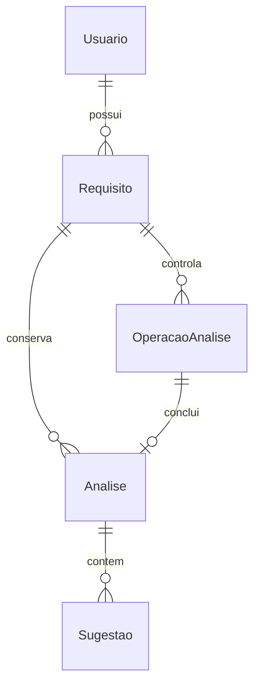

# Modelo lógico proposto — Requisita+

Data: 2026-10-18. Desenho para EF Core Code First / SQL Server Express; nenhum banco, DDL ou migration criado/executado. Origem: RF001–RF015, RN001–RN004, UC001–UC004, Q1–Q10, R1/R2/R6/R7 e T2–T4/T7. Alterações físicas dependem da aprovação deste modelo e da implementação futura.

## Entidades e relacionamentos

Uma análise válida pode ter zero sugestões. Não há compartilhamento. Propriedade de análise/sugestão é derivada da cadeia até Requisito.IdUsuario; o registro técnico também guarda IdUsuario para verificar idempotência/autorização. FKs sem cascata de exclusão física; nenhum fluxo da aplicação remove usuário, requisito, análise ou sugestão fisicamente. Identity mantém suas tabelas auxiliares normais, sem atribuir-lhes novos RF.

Tipos abaixo são o mapeamento proposto. Strings textuais Unicode; instantes `datetime2` em UTC. Chaves do domínio numéricas autoincrementadas; IDs de operação GUID gerados antes da submissão. Comprimentos são validados também no servidor; não confiar somente no banco ou cliente. Não normalizar/silenciosamente recortar título/descrição depois de confirmados. Comparação textual ordinal exata dos valores a persistir, sem depender da collation SQL; rejeitar conteúdo obrigatório só de espaços.

## Usuario / ApplicationUser

Utilizar `IdentityUser<int>`/`IdentityRole<int>` com IdentityDbContext correspondente. Identificador inteiro mantém a correspondência com IdUsuario acadêmico. Tabelas auxiliares padrão são infraestrutura, sem novo perfil funcional ou autorização por roles presumida.

| Campo | Tipo / regra |
| --- | --- |
| Id (IdUsuario conceitual) | int PK gerenciada pelo mapeamento Identity |
| Nome | nvarchar(100), obrigatório, não branco |
| Email | nvarchar(150), obrigatório e sintaticamente válido |
| NormalizedEmail | nvarchar(150), obrigatório no cadastro; índice único para unicidade concorrente |
| UserName / NormalizedUserName | derivados do e-mail para login; até 150; índices/configuração Identity coerentes |
| PasswordHash e demais campos Identity | gerenciados pelo framework; sem senha própria, limite artificial de hash ou criptografia reversível |

Senha: pelo menos oito caracteres, maiúscula, minúscula, número e especial. Nenhum Nome/Email/PasswordHash enviado ao Ollama. Não criar campo Senha legível. Cadastro/login/logout usam UI Identity; adicionar Nome e limites ao cadastro é ajuste mínimo necessário. RequireUniqueEmail e índice único NormalizedEmail devem atuar juntos, com erro de duplicidade tratado sem gravação parcial.

## Requisito

| Campo | Tipo / regra |
| --- | --- |
| IdRequisito | int PK identity |
| IdUsuario | int FK obrigatória para Identity |
| Titulo | nvarchar(150), obrigatório e não branco |
| Descricao | nvarchar(max), obrigatória; até 5.000 caracteres no servidor e CHECK coerente |
| Prioridade | nvarchar(5), CHECK Alta/Média/Baixa; obrigatória, sem default de cadastro |
| Status | nvarchar(20), CHECK Rascunho/Analisado/Revisado/Arquivado; controlado pelo serviço |
| VersaoTextual | bigint positivo, inicia 1; monotônico sem reutilização |
| UltimaOrdemAnalise | bigint não negativo, inicia 0; incrementado no commit de cada análise válida |
| DataCadastroUtc | datetime2 obrigatório |
| DataAtualizacaoUtc | datetime2 nullable, atualizado em mutações de negócio |
| RowVersion | rowversion para concorrência otimista; não é versão textual |

Índices: (IdUsuario, Status, IdRequisito) para listagem própria. O CHECK de tamanho deve considerar espaços finais de modo compatível com a validação; não usar LEN isolado se ignorar tais caracteres. Mapear limites com cuidado a UTF-16/Unicode nos testes; a aplicação conta valores de forma consistente com os contratos, sem truncar na gravação.

Alteração efetiva de Titulo ou Descricao, inclusive por Aplicada/Ajustada, incrementa VersaoTextual uma única vez por transação e retorna Rascunho. Edição idêntica não incrementa. Prioridade sozinha não muda versão nem invalida revisão. Mudança A → B → A gera versões diferentes. Snapshot de análise é obrigatório, dispensando tabela de versões completas de cada edição: o escopo exige histórico de análises, não auditoria de todas as redações intermediárias sem análise.

## Analise

Somente resultados integralmente válidos e confirmados em transação entram nesta entidade; a presença da linha significa conclusão persistida. Tentativas não concluídas pertencem a OperacaoAnalise. Conteúdo IA e snapshots são imutáveis.

| Campo | Tipo / regra |
| --- | --- |
| IdAnalise | int PK identity |
| IdRequisito | int FK obrigatória |
| IdOperacao | uniqueidentifier FK obrigatória e UNIQUE |
| VersaoTextualAnalisada | bigint positivo, versão capturada antes do envio |
| TituloAnalisado | nvarchar(150), snapshot exato enviado |
| DescricaoAnalisada | nvarchar(max), snapshot exato enviado, até 5.000 caracteres |
| DataAnaliseUtc | datetime2, instante de término válido observado |
| PersistidaEmUtc | datetime2, instante do registro no commit; não decide empates |
| OrdemPersistencia | bigint positivo, sequência do requisito atribuída em transação |
| Modelo / DigestModelo / VersaoPrompt | identificadores técnicos; modelo obrigatório; digest quando disponível sem inferência extra |
| TokensEntrada / TokensSaida | inteiros não negativos da resposta Ollama; não substituir desconhecido por zero |
| CustoApi | decimal, zero na configuração local |
| RevisaoConcluidaEmUtc | datetime2 nullable, preenchido uma única vez por confirmação humana explícita |

Índices únicos (IdRequisito, OrdemPersistencia) e IdOperacao; índice (IdRequisito, VersaoTextualAnalisada, OrdemPersistencia DESC) para ativa. Histórico ordena DataAnaliseUtc DESC, IdAnalise DESC de forma estável; a identificação da ativa usa OrdemPersistencia, não essa ordenação visual.

Metadado de conclusão humana não reescreve texto/conteúdo gerado; preserva a evidência de revisão daquela análise mesmo depois de substituída. Análise antiga pode ter revisão anteriormente concluída, mas não governa o status atual. `TextoAnalisado` acadêmico é representado pelos dois snapshots identificados; não reconstruir o título antigo a partir de Requisito atual.

## Sugestao

| Campo | Tipo / regra |
| --- | --- |
| IdSugestao | int PK identity |
| IdAnalise | int FK obrigatória |
| OrdemNoResultado | inteiro 1–5, único por análise |
| TipoProblema | nvarchar(50), CHECK nos quatro rótulos exatos aprovados |
| Explicacao | nvarchar(500), obrigatória e não branca; exemplo opcional dentro do limite |
| TextoSugerido | nvarchar(max), nullable, imutável; ausência JSON mapeia null |
| Decisao | nvarchar(20), CHECK Pendente/Aplicada/Ajustada/Descartada; inicia Pendente |
| TextoAplicado | nvarchar(max), nullable; texto final de descrição efetivamente adotado, até 5.000 caracteres |
| DecididaEmUtc | datetime2 nullable, preenchido ao confirmar decisão |
| RowVersion | rowversion, proteção da decisão única |

CHECKs coerentes: Pendente/Descartada exigem TextoAplicado nulo; Aplicada/Ajustada exigem redação válida não branca e data de decisão; Pendente sem data; decisões finais com data. A quantidade máxima de cinco filhos é garantida no serviço/contrato dentro da transação; não presumir que CHECK de uma linha conte outras linhas.

Tipos: Ambiguidade, Termo vago, Falta de clareza, Falta de especificidade. TextoSugerido não tem limite funcional adicional inventado; o contrato de saída tem o teto de tokens aprovado. Uma proposta pode ultrapassar o limite de descrição adotável: preservar o original, impedir aplicação inválida e permitir ajuste humano válido ou descarte. Sem proposta, aplicação direta é proibida, mas ajuste e descarte são permitidos.

## OperacaoAnalise — registro técnico durável

Não é quinta entidade funcional. É metadado de deduplicação, acompanhamento, consumo e recuperação (US5/SEC-005), incluído no mesmo banco para sobreviver a reinícios. Não permite edição de resultados históricos.

| Campo | Tipo / regra |
| --- | --- |
| IdOperacao | uniqueidentifier PK; GUID por confirmação |
| IdUsuario / IdRequisito | FKs obrigatórias, cadeia de propriedade conferida no servidor |
| VersaoTextual / Fingerprint | versão e hash SHA-256 de título/descrição/configuração/pedido confirmados |
| Estado | Recebida, Enviada, ResultadoDisponivel, Persistida, FalhaEncerrada ou Incerta |
| CriadaEmUtc / EnvioRegistradoEmUtc / EncerradaEmUtc | instantes técnicos; nullable quando etapa não ocorreu |
| PrazoExcedidoEmUtc | nullable, sem significado de término remoto |
| TerminoComprovado | booleano; só verdadeiro com evidência documentada |
| MotivoFalha / EvidenciaRecuperacao | códigos/resumo operacional mínimo sem textos sensíveis |
| Modelo / TokensEntrada / TokensSaida / CustoApi | consumo quando conhecido, inclusive chamada inválida/falha; tokens nullable se comunicação perdida, custo local zero |
| RowVersion | rowversion para transições de estado idempotentes |

Analise tem no máximo um registro por operação. Estado/Fingerprint não permitem reutilizar ID depois de falha. A retenção do diário não é limpo automaticamente por timeout; nesta proposta permanece preservado com o banco. Payload válido pode ficar temporariamente apenas em memória após falha SQL; Estado ResultadoDisponivel não garante sobrevivência desse payload ao restart. Não duplicar título/descrição sensíveis no diário se o hash e a versão bastarem; snapshot completo fica na análise após commit e na memória enquanto necessário.

## Consulta da ativa e atomicidade

Para requisito autorizado não arquivado: selecionar Analise com IdRequisito correspondente e VersaoTextualAnalisada igual à VersaoTextual atual, ordenada por OrdemPersistencia decrescente, primeira linha. Não havendo linha, não há ativa elegível. Em arquivados, mostrar histórico e indicação contextual, sem permitir revisão. Não buscar por igualdade de snapshot, decisão antiga ou maior ID global.

### Transação A — análise e sugestões

1. Fora da transação: confirmar, autorizar, capturar textos/versão, adquirir controle, registrar intenção de envio e executar uma chamada; validar tudo.
2. Abrir transação curta; reler requisito/propriedade e rowversion. Incrementar UltimaOrdemAnalise, inserir análise/sugestões Pendentes e atualizar diário para Persistida com término comprovado. Nenhuma sugestão herdada.
3. Se versão capturada ainda é a atual e requisito não foi arquivado, mudar Status para Analisado, inclusive após Revisado e com zero itens. Se foi editado/arquivado durante execução, preservar resultado histórico da versão enviada e não mudar status atual. Arquivamento não apaga resultado já iniciado; impede novos envios e revisões.
4. Commit único. Qualquer falha desfaz tudo, inclusive contador/status. Conflito rowversion faz rollback; regravação explícita pode reaproveitar resultado, relendo o estado. Índice único de IdOperacao permite reconhecer commit já realizado se a confirmação de rede se perder.

Em regravação, primeiro consultar IdOperacao: se já persistida, devolver existente. Não inserir duas vezes após erro ambíguo de conexão no commit. Data/ordem finais são as da persistência efetiva, sem antecipar ativa ao receber a resposta.

### Transação B — decisão humana

1. Recarregar requisito, sugestão e análise sob autorização; comparar versão textual, análise ativa esperada e tokens rowversion enviados pela tela. Exigir requisito não arquivado, sugestão Pendente e confirmação correspondente à redação final.
2. RT1 aprovada — Aplicada: a proposta da IA representa a nova descrição integral do requisito; somente usar proposta presente/válida, após o analista visualizar claramente a descrição completa resultante e confirmá-la explicitamente. Não realizar substituição silenciosa de trechos. Ajustada: o analista pode editar livremente a descrição final dentro dos limites funcionais existentes, preservando partes da redação original e incorporando as melhorias que considerar adequadas; exigir prévia completa da descrição final e confirmação explícita. Em Aplicada/Ajustada, gravar em TextoAplicado exatamente a descrição final confirmada, junto da decisão e data. Descartada: não alterar a descrição e manter TextoAplicado = null.
3. Se texto efetivamente mudou, incrementar versão, retornar Rascunho e tornar antigas sugestões inelegíveis sem alterá-las. Se não mudou, permanecer no estado atual de revisão até confirmação explícita de conclusão.
4. Atualizar linha do requisito, mesmo quando apenas descartar, para disputar rowversion com nova análise/edição. Gravar requisito e sugestão no mesmo commit. Corrida com outra aba falha integralmente; não revalidar usando nova ativa sem nova confirmação.

### Transação C — concluir revisão

Reler proprietário, requisito não arquivado, versão/ativa esperadas e rowversion. Exigir zero sugestões Pendentes da ativa, inclusive caso de lista vazia; exigir confirmação explícita distinta da última decisão. Atualizar Status para Revisado e RevisaoConcluidaEmUtc da ativa no mesmo commit. Idempotência de repetição não altera data histórica. Uma nova análise válida posterior retorna a Analisado com novo conjunto de decisões.

## Estados

| Evento | Resultado no requisito |
| --- | --- |
| Cadastro válido | Rascunho, versão 1 |
| Edição textual ou aplicação/ajuste que muda descrição | Versão +1, Rascunho; preserva todas as análises |
| Só prioridade | Mantém versão, ativa e status |
| Commit de análise válida da versão atual | Analisado e nova ativa |
| Falha, resposta inválida ou resultado sem commit | Mantém ativa/status anteriores |
| Commit de análise de versão anterior | Histórico somente; não promove versão atual |
| Última decisão sem mudança textual | Não presume conclusão humana |
| Confirmação de conclusão elegível | Revisado |
| Arquivamento P2 | Arquivado, sem apagar vínculos; edição/análise/revisão/restauração proibidas |

## Evolução controlada do esquema

Primeira migration futura deverá incluir Identity, domínio, operação, índices, FKs restritivas e CHECKs. Revisar SQL gerado e plano de recuperação antes de aplicar; não migrar automaticamente no startup. Mudanças posteriores têm migration revisável e análise de preservação; não executar rollback destrutivo de histórico como rotina. Backup abrange todo o banco. Refinamentos ao DOCX ficam registrados como proposta para atualização acadêmica futura, sem modificar o original.
