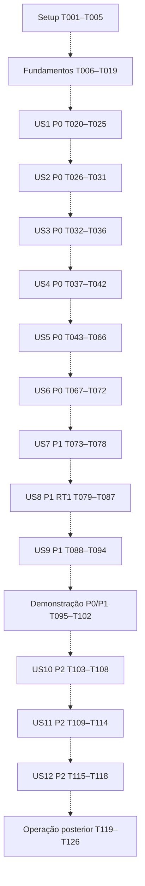

# Tasks: Requisita+ — implementação futura controlada

**Data:** 2026-10-18. **Branch observada:** `main`, preservada. **Estado:** tarefas propostas para revisão/aprovação humana; nenhuma iniciada, implementada ou testada nesta execução.

**Input:** [spec.md](spec.md), [plan.md](plan.md), [research.md](research.md), [data-model.md](data-model.md), [quickstart.md](quickstart.md), [contracts/mvc.md](contracts/mvc.md), [contracts/ollama.md](contracts/ollama.md), [checklists/requirements.md](checklists/requirements.md) e [Constituição](../../.specify/memory/constitution.md). Considerar RT1 já incorporada ao modelo e ao contrato MVC. A revisão RT2 aprovada autoriza somente ajustar dependências e organização deste arquivo; não autoriza regenerar tarefas ou iniciar implementação.

## Formato, caminhos e regras de execução futura

Formato: `- [ ] Tnnn [P?] [USn?] descrição com caminho`. IDs são sequenciais e únicos, preservados como identificadores, sem impor cronologia absoluta de preparação. `[P]` indica trabalho em arquivos distintos que pode ocorrer em paralelo **somente depois das dependências técnicas declaradas**; não autoriza inferências simultâneas. Histórias mantêm P0/P1/P2 originais. Caminhos são relativos à raiz e representam arquivos futuros, ainda não criados por esta geração. Diretórios em tarefas de esquema indicam conjuntos de arquivos produzidos pelo EF, cujos nomes finais dependem da ferramenta.

RT2 distingue três categorias: **`Deps:` são pré-requisitos técnicos obrigatórios** da tarefa, incluindo artefatos, código, fixtures e recursos necessários; **fases e entradas de sequência indicam a entrega recomendada**, não um bloqueio global de preparação; **marcos de validação e aprovação humana condicionam a conclusão** da história/incremento. As referências de entrada das fases abaixo devem ser lidas nessa distinção, e não como exigência de terminar todas as fases anteriores para preparar uma verificação independente.

Toda tarefa depende da aprovação humana da implementação e das operações envolvidas; qualquer operação real futura com banco ou Ollama exige autorização específica. Tarefas de testes aparecem antes da implementação relacionada para orientar o comportamento. Cenários podem ser preparados com contratos e pré-requisitos disponíveis; compilar/executar exige também o código efetivamente disponível sob teste. Se uma tarefa reúne preparação e execução, a antecipação de uma parte não a torna concluída: a caixa permanece desmarcada até satisfazer todo o aceite. Serviço/modelo/ferramenta ausente é impedimento a registrar, não licença para instalar, inferir ou alterar banco. A suite padrão usa simulações; integrações SQL Server e Ollama são opt-in e possuem tarefas próprias. Simulações não comprovam funcionamento real de nenhum desses serviços. Registros futuros ficam em `docs/validacao/`, sem editar automaticamente fontes aprovadas.

Os seis grupos solicitados correspondem a: preparação (fases 1–2), identidade/gestão (3–6), IA (7–8), revisão/histórico (9–11), demonstração (12), P2/operação posterior (13–16). Cada US tem objetivo e critério de teste independente com dados preparados; dependência de infraestrutura ou fixtures não implica executar as outras histórias ao vivo para testá-la.

## Fase 1 — Setup da solução (incremento 1)

Objetivo: preparar o único executável MVC e um projeto xUnit, sem infraestrutura adicional. Entrada futura: aprovação das tarefas. Saída: versões e pré-requisitos documentados, estrutura e dependências coerentes com o plano.

- [x] T001 Inventariar SDK .NET 10, SQL Server Express/instância/porta/conta, Ollama/modelo local, ferramentas EF e memória disponível em `docs/validacao/ambiente.md`; registrar ausências, sem presumir instalação, baixar modelo ou inferir; definir diretório/conta protegidos de backup e ambiente separado de testes antes de operações reais. Deps: aprovação humana. Aceite: versões, limitações e ações que ainda requerem autorização explícitas.
- [x] T002 Criar a solução `RequisitaPlus.slnx` e o projeto `src/RequisitaPlus.Web/RequisitaPlus.Web.csproj` como único executável ASP.NET Core MVC `net10.0`, com Controllers/Models/Views/ViewModels/Services/Data e Razor; sem projeto frontend, microsserviços ou Docker obrigatório. Deps: T001. Aceite: estrutura do plan.md, sem funcionalidades presumidas.
- [x] T003 Configurar referências compatíveis de EF Core 10/SQL Server, Identity UI e ferramentas locais em `src/RequisitaPlus.Web/RequisitaPlus.Web.csproj`, `.config/dotnet-tools.json` e `global.json`, registrando versões exatas compatíveis com T001. Deps: T002. Aceite: dependências mínimas; nenhum serviço pago, API externa ou runtime adicional obrigatório.
- [x] T004 Criar `tests/RequisitaPlus.Tests/RequisitaPlus.Tests.csproj` com xUnit e pastas Unit/Contracts/Integration/SqlServer/Integration/Ollama; configurar opt-in real em `tests/RequisitaPlus.Tests/Support/IntegrationGate.cs`. Deps: T003. Aceite: execução padrão não toca SQL/Ollama, e integrações não usam banco principal por fallback.
- [x] T005 Configurar HTTPS, ambiente local e proteção de segredos em `src/RequisitaPlus.Web/Properties/launchSettings.json`, `src/RequisitaPlus.Web/appsettings.json` e `.gitignore`; connection string real por User Secrets/ambiente, sem credenciais versionadas. Deps: T003. Aceite: navegador por HTTPS, uma instância Web e nenhuma migration automática no startup.

## Fase 2 — Fundamentos compartilhados (incremento 1)

Fornece os fundamentos compartilhados exigidos pelas dependências de cada tarefa; não bloqueia globalmente a preparação independente até T019. A validação real do esquema em T019 continua obrigatória para o aceite da base, para as integrações que a exigem e para o marco T025. Modelo completo comum é infraestrutura; não antecipa telas/fluxos P2. Restrições entre aspas abaixo reproduzem o modelo aprovado; sua aplicação não fica à discrição da implementação.

- [x] T006 Modelar `src/RequisitaPlus.Web/Models/ApplicationUser.cs` com IdentityUser<int>/IdentityRole<int>: Id "int PK gerenciada pelo mapeamento Identity"; Nome "nvarchar(100), obrigatório, não branco"; Email "nvarchar(150), obrigatório e sintaticamente válido"; NormalizedEmail "nvarchar(150), obrigatório no cadastro; índice único para unicidade concorrente"; UserName/NormalizedUserName "derivados do e-mail para login; até 150; índices/configuração Identity coerentes"; PasswordHash/campos Identity "gerenciados pelo framework; sem senha própria, limite artificial de hash ou criptografia reversível". Deps: T003. Aceite: mecanismo padrão, sem coluna Senha legível.
- [x] T007 Modelar `src/RequisitaPlus.Web/Models/Requisito.cs`: IdRequisito "int PK identity"; IdUsuario "int FK obrigatória para Identity"; Titulo "nvarchar(150), obrigatório e não branco"; Descricao "nvarchar(max), obrigatória; até 5.000 caracteres no servidor e CHECK coerente"; Prioridade "nvarchar(5), CHECK Alta/Média/Baixa; obrigatória, sem default de cadastro"; Status "nvarchar(20), CHECK Rascunho/Analisado/Revisado/Arquivado; controlado pelo serviço"; VersaoTextual "bigint positivo, inicia 1; monotônico sem reutilização"; UltimaOrdemAnalise "bigint não negativo, inicia 0; incrementado no commit de cada análise válida"; DataCadastroUtc "datetime2 obrigatório"; DataAtualizacaoUtc "datetime2 nullable, atualizado em mutações de negócio"; RowVersion "rowversion para concorrência otimista; não é versão textual". Deps: T006. Aceite: proprietário obrigatório, sem edição manual de status.
- [x] T008 Modelar `src/RequisitaPlus.Web/Models/Analise.cs`: IdAnalise "int PK identity"; IdRequisito "int FK obrigatória"; IdOperacao "uniqueidentifier FK obrigatória e UNIQUE"; VersaoTextualAnalisada "bigint positivo, versão capturada antes do envio"; TituloAnalisado "nvarchar(150), snapshot exato enviado"; DescricaoAnalisada "nvarchar(max), snapshot exato enviado, até 5.000 caracteres"; DataAnaliseUtc "datetime2, instante de término válido observado"; PersistidaEmUtc "datetime2, instante do registro no commit; não decide empates"; OrdemPersistencia "bigint positivo, sequência do requisito atribuída em transação"; Modelo/DigestModelo/VersaoPrompt "identificadores técnicos; modelo obrigatório; digest quando disponível sem inferência extra"; TokensEntrada/TokensSaida "inteiros não negativos da resposta Ollama; não substituir desconhecido por zero"; CustoApi "decimal, zero na configuração local"; RevisaoConcluidaEmUtc "datetime2 nullable, preenchido uma única vez por confirmação humana explícita". Deps: T007. Aceite: somente resultados válidos persistidos, snapshots imutáveis e metadado humano separado.
- [x] T009 Modelar `src/RequisitaPlus.Web/Models/Sugestao.cs`: IdSugestao "int PK identity"; IdAnalise "int FK obrigatória"; OrdemNoResultado "inteiro 1–5, único por análise"; TipoProblema "nvarchar(50), CHECK nos quatro rótulos exatos aprovados" (Ambiguidade, Termo vago, Falta de clareza, Falta de especificidade); Explicacao "nvarchar(500), obrigatória e não branca; exemplo opcional dentro do limite"; TextoSugerido "nvarchar(max), nullable, imutável; ausência JSON mapeia null"; Decisao "nvarchar(20), CHECK Pendente/Aplicada/Ajustada/Descartada; inicia Pendente"; TextoAplicado "nvarchar(max), nullable; texto final de descrição efetivamente adotado, até 5.000 caracteres"; DecididaEmUtc "datetime2 nullable, preenchido ao confirmar decisão"; RowVersion "rowversion, proteção da decisão única". Deps: T008. Aceite: proposta sem limite funcional extra inventado; RT1 preservada.
- [x] T010 Modelar `src/RequisitaPlus.Web/Models/OperacaoAnalise.cs`: IdOperacao "uniqueidentifier PK; GUID por confirmação"; IdUsuario/IdRequisito "FKs obrigatórias, cadeia de propriedade conferida no servidor"; VersaoTextual/Fingerprint "versão e hash SHA-256 de título/descrição/configuração/pedido confirmados"; Estado "Recebida, Enviada, ResultadoDisponivel, Persistida, FalhaEncerrada ou Incerta"; CriadaEmUtc/EnvioRegistradoEmUtc/EncerradaEmUtc "instantes técnicos; nullable quando etapa não ocorreu"; PrazoExcedidoEmUtc "nullable, sem significado de término remoto"; TerminoComprovado "booleano; só verdadeiro com evidência documentada"; MotivoFalha/EvidenciaRecuperacao "códigos/resumo operacional mínimo sem textos sensíveis"; Modelo/TokensEntrada/TokensSaida/CustoApi "consumo quando conhecido, inclusive chamada inválida/falha; tokens nullable se comunicação perdida, custo local zero"; RowVersion "rowversion para transições de estado idempotentes". Deps: T008. Aceite: diário durável, sem apagar por timeout ou reutilizar ID de falha.
- [x] T011 Implementar `src/RequisitaPlus.Web/Data/ApplicationDbContext.cs` e mapeamentos em `src/RequisitaPlus.Web/Data/Configurations/`: Identity, domínio/diário, FKs sem cascata física, índices únicos de NormalizedEmail, IdOperacao em Analise, (IdRequisito, OrdemPersistencia) e (IdAnalise, OrdemNoResultado); índices de listagem/ativa do data-model.md. Deps: T006–T010. Aceite: Unicode, UTC, CHECKs de tamanho/domínio/TextoAplicado/data de decisão e rowversion; espaços finais/UTF-16 não burlam limites; máximo de cinco filhos será validado no serviço, não presumido por CHECK de linha.
- [x] T012 Registrar MVC/Razor Pages/Identity, cookies e autorização padrão em `src/RequisitaPlus.Web/Program.cs`: senha "pelo menos oito caracteres, maiúscula, minúscula, número e especial", RequireUniqueEmail, sem SMTP/confirmação de e-mail obrigatória; login por e-mail e logout protegido. Deps: T005, T011. Aceite: hashing Identity, antiforgery nos POSTs e rotas de domínio autenticadas.
- [x] T013 Implementar consultas de propriedade em `src/RequisitaPlus.Web/Services/Requisitos/AcessoProprietarioService.cs` para requisito → análise → sugestão e diário; usuário exclusivamente da identidade do servidor. Deps: T011, T012. Aceite: IDs alheios equivalentes a inexistentes, sem conteúdo revelado; sem confiar em OwnerId recebido ou só em filtros de View.
- [x] T014 Configurar erros/logs mínimos e conversão UTC/America/Sao_Paulo em `src/RequisitaPlus.Web/Services/RelogioLocal.cs` e `src/RequisitaPlus.Web/Program.cs`. Deps: T012. Aceite: relógio substituível nos testes, sem UTC-3 fixo, sem senha/prompt/texto completo nos logs e sem bloqueio por data/horário.
- [x] T015 Centralizar Options/validação em `src/RequisitaPlus.Web/Services/IA/OllamaOptions.cs`, `src/RequisitaPlus.Web/Services/IA/OllamaOptionsValidator.cs` e `src/RequisitaPlus.Web/appsettings.json`: endereço exato http://127.0.0.1:11434, qwen2.5:3b, 4096/1024 tokens, 60 s, 5m, cinco problemas. Deps: T005, T014. Aceite: ajustes por ambiente dentro dos limites; inválido desabilita apenas IA quando Web/SQL funcionam; nenhum fallback externo ou URL de formulário.
- [x] T016 Criar fixtures não produtivas e simuladores em `tests/RequisitaPlus.Tests/Support/FakeOllamaHandler.cs`, `tests/RequisitaPlus.Tests/Support/ControlledClock.cs` e `tests/RequisitaPlus.Tests/Support/TestData.cs`. Deps: T004, T006–T010, T014. Aceite: HttpMessageHandler simulado independente da interface IA ainda não criada, dois usuários, versões/análises/sugestões válidas e barreiras determinísticas; dados simulados identificados e nunca apresentados como histórico real.
- [x] T017 Gerar/revisar migration inicial em `src/RequisitaPlus.Web/Data/Migrations/` e SQL de revisão em `docs/validacao/esquema-inicial.sql`; documentar preservação/recuperação em `docs/validacao/migrations.md`. Deps: T005, T011, T012. Aceite: modelo/índices/restrições conferidos, sem auto-migrate no startup ou rollback destrutivo; aplicar somente após revisão e autorização do alvo.
- [ ] T018 Preparar fixture SQL Express opt-in em `tests/RequisitaPlus.Tests/Integration/SqlServer/SqlServerFixture.cs` e configuração local protegida; aplicar migration aprovada somente ao banco descartável explicitamente escolhido. Deps: T001, T004, T017. Aceite: aborta sem conexão de testes explícita; nunca seleciona principal/LocalDB/outro banco como alternativa.
- [ ] T019 Criar e executar verificação inicial em `tests/RequisitaPlus.Tests/Integration/SqlServer/SchemaTests.cs`, registrando em `docs/validacao/base.md` relações, limites, índices únicos e rowversion reais. Deps: T016, T018. Aceite: integridade relacional comprovada no SQL Express; EF InMemory não substitui essa evidência; falhas bloqueiam histórias.

## Fase 3 — US1: identidade autenticada (P0; incremento 1)

Objetivo: cadastro/login/logout Identity seguros. Sequência recomendada de entrega: após fase 2; preparação conforme as dependências técnicas de cada tarefa. Teste independente: conta preparada e cadastro separado sem análises; inválidos e visitante não acessam domínio. Origem: US1.1–US1.4, Segurança de acesso, SEC-001/SEC-002 e Constituição V.

- [x] T020 [P] [US1] Escrever testes de limites, espaços, e-mail e senha em `tests/RequisitaPlus.Tests/Unit/IdentityValidationTests.cs`, cobrindo política de T006/T012 e duplicidade normalizada. Deps: T004, T006, T012. Aceite: matriz válida/inválida inclui nome 100/101, e-mail 150/acima e senha sem cada classe exigida.
- [x] T021 [P] [US1] Escrever contrato HTTP de registro/login/logout e visitante em `tests/RequisitaPlus.Tests/Contracts/IdentityHttpTests.cs`. Deps: T004, T005, T012, T016. Aceite: autenticação e antiforgery também em acesso direto; nenhum teste chama Ollama.
- [x] T022 [US1] Ajustar somente o cadastro padrão em `src/RequisitaPlus.Web/Areas/Identity/Pages/Account/Register.cshtml.cs` e `src/RequisitaPlus.Web/Areas/Identity/Pages/Account/Register.cshtml` para Nome, Email e validação cliente/servidor aprovados. Deps: T020, T021. Aceite: usuário utilizável sem SMTP; identidade/credenciais gerenciadas pelo framework.
- [x] T023 [US1] Integrar páginas padrão de login/logout e navegação em `src/RequisitaPlus.Web/Views/Shared/_LoginPartial.cshtml` e `src/RequisitaPlus.Web/Program.cs`, sem autenticação própria. Deps: T022. Aceite: entrar por e-mail, negar senha incorreta, logout POST e área protegida inacessível depois de sair.
- [ ] T024 [US1] Tratar colisão concorrente de NormalizedEmail no fluxo de `src/RequisitaPlus.Web/Areas/Identity/Pages/Account/Register.cshtml.cs` e cobri-la em `tests/RequisitaPlus.Tests/Integration/SqlServer/IdentityUniquenessTests.cs`. Deps: T023. Aceite: duas solicitações concorrentes não geram contas duplicadas nem sucesso falso.
- [ ] T025 [US1] Executar testes de US1, validação manual da UI Identity e inspeção segura de armazenamento, registrando em `docs/validacao/us1.md`. Deps: T019, T020–T024. Aceite: hash framework, resultados/falhas/não executados explícitos e nenhum segredo no relatório; gate do incremento 1.

## Fase 4 — US2: cadastrar requisito (P0; incremento 2)

Objetivo: cadastro válido com prioridade explícita e proprietário. Sequência recomendada de entrega: após US1; preparação conforme as dependências técnicas de cada tarefa. Teste independente: criar com conta preparada e reabrir pelo serviço/fixture, sem análise. Origem: RF001/RF004, RN001, UC001; US2.1–US2.3.

- [x] T026 [P] [US2] Escrever contrato POST de cadastro em `tests/RequisitaPlus.Tests/Contracts/RequisitoCreateHttpTests.cs`: obrigatório/não branco, limites 150/5.000, prioridade ausente/indevida, antiforgery, OwnerId/Status forjados e falha SQL. Deps: T004, T007, T012, T013, T016. Aceite: nenhum inválido cria registro ou anuncia sucesso.
- [x] T027 [P] [US2] Escrever testes de validação/inicialização em `tests/RequisitaPlus.Tests/Unit/RequisitoCadastroTests.cs`, incluindo Unicode/espaços finais, Rascunho, versão 1 e contador 0. Deps: T004, T007, T016. Aceite: prioridades Alta/Média/Baixa sem escolha automática.
- [x] T028 [US2] Implementar `src/RequisitaPlus.Web/ViewModels/Requisitos/CriarRequisitoViewModel.cs` com as restrições textuais/enum de T007 e validação cliente/servidor consistente. Deps: T026, T027. Aceite: descrição até 5.000 não pressupõe caber no contexto IA; não aceitar Status/IdUsuario como mutação.
- [x] T029 [US2] Implementar cadastro em `src/RequisitaPlus.Web/Services/Requisitos/CadastroRequisitoService.cs`, atribuindo identidade, UTC e estado inicial do servidor. Deps: T028, T013. Aceite: commit precede sucesso; erro preserva ausência de registro incompleto.
- [x] T030 [US2] Implementar GET/POST Criar em `src/RequisitaPlus.Web/Controllers/RequisitosController.cs` e `src/RequisitaPlus.Web/Views/Requisitos/Criar.cshtml`. Deps: T029. Aceite: formulário com prioridade sem default, erros por campo e POST/redirect/GET sem duplicação por refresh.
- [ ] T031 [US2] Validar cadastro real no banco de testes em `tests/RequisitaPlus.Tests/Integration/SqlServer/RequisitoCadastroTests.cs` e registrar resultados em `docs/validacao/us2.md`. Deps: T026–T030. Aceite: dados reabertos idênticos e recusa de entradas inválidas/falha de gravação conforme US2.

## Fase 5 — US3: listar e consultar (P0; incremento 2)

Objetivo: localizar somente requisitos próprios. Sequência recomendada de entrega: após US2; preparação conforme as dependências técnicas de cada tarefa. Teste independente: fixtures de dois proprietários, registros arquivados e identificador inexistente. Origem: RF015, UC001/UC002; US3.1–US3.4 e SEC-002.

- [x] T032 [P] [US3] Escrever testes HTTP de listagem/detalhe/IDs diretos em `tests/RequisitaPlus.Tests/Contracts/RequisitoReadHttpTests.cs`. Deps: T004, T012, T013, T016. Aceite: visitante negado, outro usuário sem leitura, inexistente com mensagem prevista e lista principal sem arquivados.
- [x] T033 [P] [US3] Escrever testes de projeção/lista vazia em `tests/RequisitaPlus.Tests/Unit/RequisitoConsultaTests.cs`. Deps: T004, T007, T016. Aceite: título/descrição/prioridade/status armazenados, sem dados fictícios ou inferência.
- [x] T034 [US3] Implementar consulta/projeções próprias em `src/RequisitaPlus.Web/Services/Requisitos/ConsultaRequisitoService.cs` e `src/RequisitaPlus.Web/ViewModels/Requisitos/DetalhesRequisitoViewModel.cs`. Deps: T032, T033, T013. Aceite: filtro do proprietário no servidor e cadeia de autorização reaproveitável.
- [x] T035 [US3] Implementar Index/Detalhes em `src/RequisitaPlus.Web/Controllers/RequisitosController.cs`, `src/RequisitaPlus.Web/Views/Requisitos/Index.cshtml` e `src/RequisitaPlus.Web/Views/Requisitos/Detalhes.cshtml`. Deps: T034. Aceite: texto codificado no Razor, estado vazio e “Requisito não encontrado” sem vazamento.
- [ ] T036 [US3] Executar cenários US3 com dois usuários em `tests/RequisitaPlus.Tests/Integration/SqlServer/ProprietarioConsultaTests.cs` e registrar em `docs/validacao/us3.md`. Deps: T032–T035. Aceite: acesso direto/consulta não revela nem modifica dados alheios.

## Fase 6 — US4: editar preservando análises (P0; incremento 2)

Objetivo: edição segura de texto/prioridade, sem perda histórica. Sequência recomendada de entrega: após US3; análises preparadas na fixture permitem teste independente antes do fluxo de IA. Origem: RF002/RF004/RF009, RN001/RN004, UC001; US4.1–US4.5, R1.

- [x] T037 [P] [US4] Escrever testes de versão textual em `tests/RequisitaPlus.Tests/Unit/VersionamentoTextualTests.cs`: título ou descrição incrementam uma vez, edição idêntica não, só prioridade conserva, A→B→A gera terceira versão e não reativa a primeira. Deps: T004, T007, T016. Aceite: comparação ordinal exata e status conforme modelo.
- [ ] T038 [P] [US4] Escrever cenários de duas abas/rowversion e preservação em `tests/RequisitaPlus.Tests/Integration/SqlServer/RequisitoEdicaoConcorrenteTests.cs`, com fixture histórica. Deps: T016, T018. Aceite: conflito/erro faz rollback; análises/sugestões/decisões e Pendentes antigas não são apagadas/modificadas.
- [x] T039 [US4] Implementar `src/RequisitaPlus.Web/ViewModels/Requisitos/EditarRequisitoViewModel.cs` com T007, VersaoEsperada/RowVersion e sem campos de status/proprietário editáveis. Deps: T037, T038. Aceite: acesso direto inválido é rejeitado, sem truncar texto.
- [x] T040 [US4] Implementar edição/versionamento em `src/RequisitaPlus.Web/Services/Requisitos/EdicaoRequisitoService.cs`: autorização, bloqueio de arquivado, rowversion, UTC, +1/Rascunho só por mudança textual e prioridade isolada conservando estado. Deps: T013, T039. Aceite: nenhuma operação histórica/descartes automáticos e nenhum retry automático de decisão.
- [x] T041 [US4] Integrar GET/POST Editar em `src/RequisitaPlus.Web/Controllers/RequisitosController.cs` e `src/RequisitaPlus.Web/Views/Requisitos/Editar.cshtml`, com mensagem de conflito e recarga explícita. Deps: T040. Aceite: edição confirmada corresponde ao texto persistido; falha não anuncia atualização.
- [ ] T042 [US4] Executar US4, regressão US1–US3 e testes SQL de concorrência, registrando em `docs/validacao/us4.md`. Deps: T025, T031, T036, T037–T041. Aceite: incremento 2 demonstrável, incluindo limites, versão, prioridade e histórico preparado preservado.

## Fase 7 — US5: análise local por IA (P0; incremento 3)

Objetivo: uma chamada local confirmada, com contexto seguro, deduplicação, recuperação e persistência atômica. Sequência recomendada de entrega: após US4; preparação e verificações independentes conforme `Deps:`, mantendo gate offline de contexto obrigatório antes de qualquer inferência real. Teste independente: requisito/conta preparados e respostas simuladas para provar regras; integração real separada para provar funcionamento local. Origem: RF005/RF006/RF009, RN001/RN002/RN004, UC002; US5.1–US5.12, Q5/Q9/R6/R7 e SEC-003–SEC-005.

- [ ] T043 [P] [US5] Escrever testes do contrato JSON/envelope/configuração em `tests/RequisitaPlus.Tests/Contracts/OllamaContractTests.cs`: 0–5 problemas, quatro tipos exatos, explicação não branca até 500 sem exemplo obrigatório, proposta ausente/null/string, UTF-16; rejeitar propriedades extras/duplicadas, Markdown, texto residual, tipos errados, JSON incompleto e término por limite mesmo com JSON parseável. Deps: T004, T015, T016. Aceite: validação integral sem correção, cortes ou retry.
- [ ] T044 [P] [US5] Escrever testes simulados de execução em `tests/RequisitaPlus.Tests/Unit/AnaliseExecutionTests.cs`: semáforo global entre usuários, Wait(0), dedup de ID/fingerprint, 60 s com tarefa ativa, cancelamento/desconexão, resposta tardia, reinício incerto e falha antes/depois de envio. Deps: T004, T016. Aceite: contadores/barreiras/relógio controlados comprovam uma chamada por operação e ausência de fila/liberação prematura.
- [ ] T045 [P] [US5] Escrever testes reais SQL de persistência/R7 em `tests/RequisitaPlus.Tests/Integration/SqlServer/AnalisePersistenceTests.cs`, usando IA simulada: falha em sugestão/status/commit, ordem concorrente, duplicação IdOperacao, edição durante análise e regravação tardia. Deps: T016, T018. Aceite: rollback completo; só commit válido define ativa e status, sem conexão com Ollama real.
- [ ] T046 [US5] Implementar indicadores em `src/RequisitaPlus.Web/Services/Analises/IndicadoresTextuaisService.cs` com todos os grupos/expressões de contracts/ollama.md, origem/trecho e candidatos deduplicados sem alterar título/descrição. Deps: T043. Aceite: candidatos não produzem diagnóstico; ausência deles não impede análise local.
- [ ] T047 [US5] Definir contratos internos e prompt raw versionado em `src/RequisitaPlus.Web/Services/IA/IOllamaClient.cs`, `src/RequisitaPlus.Web/Services/IA/OllamaDtos.cs` e `src/RequisitaPlus.Web/Services/IA/PromptBuilder.cs`: requisito integral/candidatos delimitados como dados, instruções/schema e limites aprovados, sem dados da conta. Deps: T046. Aceite: uma serialização exata contabilizável, sem prompt sensível em log ou instrução do requisito tratada como autorização.
- [ ] T048 [US5] Verificar offline o tokenizer/artefato Qwen local, raw e sobrecarga BOS/EOS, documentando evidência em `docs/validacao/contexto-tokenizer.md`. Deps: T001, T047. Aceite: demonstrar limite superior bytes UTF-8 + sobrecarga do prompt integral; se não demonstrável, manter IA bloqueada e resolver contador exato local compatível conforme decisão D6, submetendo dependência nova à revisão; proibido inferir para sondar capacidade ou usar caracteres÷4.
- [ ] T049 [US5] Implementar guarda pré-envio em `src/RequisitaPlus.Web/Services/IA/ContextGuard.cs` e casos de borda em `tests/RequisitaPlus.Tests/Unit/ContextGuardTests.cs`. Deps: T047, T048. Aceite: prompt final completo + sobrecarga verificada + reserva 1.024 <=4.096; gate não comprovado/excesso bloqueia chamada, sem cortar/resumir/retirar candidatos ou reduzir limite cadastral de 5.000.
- [ ] T050 [US5] Implementar validador/schema em `src/RequisitaPlus.Web/Services/IA/OllamaResponseValidator.cs`, conforme T043: envelope íntegro, done=true, motivo normal verificado, contadores válidos dentro dos limites e objeto problemas completo. Deps: T043, T047. Aceite: rejeição integral de inválido/truncado/length, exemplos opcionais e lista vazia válida; preservar TextoSugerido original inclusive quando branco.
- [ ] T051 [US5] Implementar cliente HTTP tipado em `src/RequisitaPlus.Web/Services/IA/OllamaClient.cs` e registro em `src/RequisitaPlus.Web/Program.cs`: somente POST local /api/generate, raw=true, stream=false, schema, num_ctx=4096, num_predict=1024 e keep_alive=5m via Options. Deps: T015, T049, T050. Aceite: redirects/proxy/retry/fallback/aquecimento automático desabilitados; deadline é do supervisor, HttpClient.Timeout não libera capacidade por conta própria.
- [ ] T052 [US5] Implementar diário/idempotência em `src/RequisitaPlus.Web/Services/Analises/OperacaoAnaliseService.cs`: GUID por confirmação, fingerprint vinculado ao proprietário/requisito/versão/configuração, gravação Enviada antes do primeiro byte possível e controle rowversion. Deps: T044, T045, T010, T013. Aceite: falha ao gravar intenção impede envio; mesmo ID retorna estado/resultado e nunca reinfere, inclusive após falha/restart; conteúdo diferente conflita; diário não armazena texto sensível desnecessário.
- [ ] T053 [US5] Implementar supervisor singleton em `src/RequisitaPlus.Web/Services/IA/InferenciaSupervisor.cs`, registrado no mesmo executável em `src/RequisitaPlus.Web/Program.cs`. Deps: T051, T052. Aceite: SemaphoreSlim(1,1)/Wait(0), ocupado imediato sem fila; tarefa observada e posse independente da Controller/RequestAborted; DbContext criado por escopos próprios, nunca retido no singleton.
- [ ] T054 [US5] Implementar deadline/cancelamento seguro em `src/RequisitaPlus.Web/Services/IA/InferenciaSupervisor.cs`: timeout funcional aos 60 s, transporte ainda observado quando possível, estado Incerta sem prova terminal e descarte funcional de resposta tardia. Deps: T053. Aceite: finally/timer/desconexão não liberam por presunção; prova terminal inválida pode liberar capacidade sem criar análise; consumo desconhecido permanece desconhecido, custo API zero.
- [ ] T055 [US5] Implementar bloqueio/reconciliação no startup em `src/RequisitaPlus.Web/Services/IA/RecuperacaoInferenciaService.cs` e `src/RequisitaPlus.Web/Program.cs`. Deps: T052, T054. Aceite: envio sem TerminoComprovado/estado Incerta ou diário inacessível bloqueia IA mesmo com semáforo novo; não bloquear funções independentes de IA quando Web/SQL funcionam; sem liberação por /api/ps, keep_alive ou simples restart Web.
- [ ] T056 [US5] Implementar transação A em `src/RequisitaPlus.Web/Services/Analises/PersistenciaAnaliseService.cs` e consulta R7 em `src/RequisitaPlus.Web/Services/Analises/AnaliseAtivaService.cs`. Deps: T045, T052. Aceite: análise válida + 0–5 sugestões Pendentes + ordem + status + diário em commit único, sem SQL aberto durante HTTP; ativa por versão atual/maior OrdemPersistencia, falha mantém anterior, sucesso atual retorna Revisado a Analisado; resultado de versão antiga/arquivado permanece histórico sem mudar estado atual; disputar rowversion do requisito.
- [ ] T057 [US5] Implementar retenção temporária/regravação em `src/RequisitaPlus.Web/Services/Analises/ResultadoTemporarioStore.cs` e `src/RequisitaPlus.Web/Services/Analises/PersistenciaAnaliseService.cs`. Deps: T055, T056. Aceite: resultado validado disponível só ao dono/operação no mesmo processo; tentativa explícita de gravação sem inferência, consulta IdOperacao antes de inserir após commit ambíguo; perda em restart é informada e nunca reenvia ID; recebimento sem commit não promove ativa/status.
- [ ] T058 [US5] Implementar confirmação/entradas em `src/RequisitaPlus.Web/ViewModels/Analises/ConfirmarAnaliseViewModel.cs` e `src/RequisitaPlus.Web/Views/Analises/Confirmar.cshtml`, reutilizando rota de confirmação existente. Deps: T049, T052. Aceite: informa processamento local de título/descrição/candidatos, exige confirmação por análise e versão/rowversion vistas; cancelamento não infere nem altera requisito; mudança interveniente exige nova prévia/confirmação.
- [ ] T059 [US5] Orquestrar Confirmar/Iniciar/Operacao em `src/RequisitaPlus.Web/Controllers/AnalisesController.cs` e `src/RequisitaPlus.Web/Views/Analises/Operacao.cshtml`, delegando aos serviços. Deps: T054–T058. Aceite: autorização/antiforgery/validação, status da operação não é conclusão, refresh/reabertura não criam ID/envio, ocupado/timeout/indisponível têm causa e “Não foi possível concluir a análise”; GET não altera nem infere.
- [ ] T060 [US5] Integrar POST Regravar em `src/RequisitaPlus.Web/Controllers/AnalisesController.cs` e ação explícita em `src/RequisitaPlus.Web/Views/Analises/Operacao.cshtml`. Deps: T057, T059. Aceite: só payload válido preservado do dono, sem reinferir, duplicar commit ou anunciar sucesso antes da transação.
- [ ] T061 [US5] Preparar procedimento operacional restrito em `docs/operacao/recuperacao-inferencia.md` e reconciliação parametrizada do diário em `scripts/operacao/Reconciliar-Inferencia.ps1`. Deps: T055, T060. Aceite: manutenção com Web parada, identificação exata da operação/banco e evidência do operador de término efetivo da instância dedicada Ollama e seus processos antes de reiniciar/reconciliar; dúvida mantém bloqueio; não expor botão comum, matar processos automaticamente, apagar histórico ou reenviar operação incerta.
- [ ] T062 [US5] Executar suite simulada de US5 e registrar em `docs/validacao/us5-simulado.md`, corrigindo defeitos nos arquivos T046–T061 sem relaxar contratos. Deps: T043–T061. Aceite: chamadas contadas, cancelamento sem inferência, ocupado imediato, falhas/timeout/reinício/resposta tardia seguros e ausência de diagnóstico automático por indicadores.
- [ ] T063 [US5] Executar T045 com SQL Express separado e IA simulada, registrando em `docs/validacao/us5-sql.md`. Deps: T019, T045, T052, T056, T057 e autorização específica de integração SQL. Aceite: rollback e unicidade reais, rowversion, resultado antigo, regravação e R7 preservam integridade mesmo sob duas abas; nenhum dado simulado vira histórico real de demonstração.
- [ ] T064 [US5] Criar/executar integração Ollama opt-in em `tests/RequisitaPlus.Tests/Integration/Ollama/OllamaCompatibilityTests.cs` e registrar em `docs/validacao/us5-ollama.md`. Deps: T048, T059, T063 e autorização específica de chamadas reais ao Ollama e gravações no banco de testes. Aceite: conferir versão/modelo/digest e suporte raw/schema/sinal terminal/contadores antes de habilitar execução; requisito curto confirmado produz uma chamada autorizada com limites aprovados e commit válido; sem compatibilidade, manter gate fechado sem formato alternativo silencioso.
- [ ] T065 [US5] Medir primeira chamada fria e chamadas posteriores confirmadas com SQL/Web/Ollama juntos em `docs/validacao/memoria-latencia-inicial.md`, sem inferência automática de aquecimento. Deps: T064. Aceite: registrar RAM total/livre/pico, paginação, latência, tokens e OOM/timeout reais; reduzir processos dispensáveis e só ajustar teto SQL após medição/revisão, sem prometer 60 s ou alterar modelo/limites.
- [ ] T066 [US5] Validar ciclo integrado US5 e ensaio seguro da recuperação em `docs/validacao/us5.md`, distinguindo simulações, SQL e Ollama reais, inclusive o que não pôde ser verificado. Deps: T061–T065. Aceite: demonstrar que prazo/desconexão não autorizam segunda inferência e que funções sem IA continuam; falhas no gate de contexto/término impedem aceitar integração como concluída.

## Fase 8 — US6: ler e reabrir resultado (P0; incremento 3)

Objetivo: resultado persistido compreensível e imutável. Sequência recomendada de entrega: após US5; teste independente usa análise preparada, inclusive zero problemas, sem fazer chamada real. Origem: RF006–RF009, RN002/RN004, UC002/UC004; US6.1–US6.6 e SC-003.

- [ ] T067 [P] [US6] Escrever contrato de leitura/reabertura em `tests/RequisitaPlus.Tests/Contracts/AnaliseResultadoHttpTests.cs`: proprietário, inexistente/ausência, resultado vazio, sem proposta, explicação sem exemplo e nenhuma inferência/mutação por GET. Deps: T004, T012, T013, T016. Aceite: retorno conserva origem e estados históricos.
- [ ] T068 [US6] Implementar `src/RequisitaPlus.Web/ViewModels/Analises/ResultadoAnaliseViewModel.cs` com snapshots/versão/data, apontamentos, propostas, decisões e TextoAplicado distintos. Deps: T067. Aceite: não reconstruir texto antigo do requisito atual nem inventar conteúdo para ausência.
- [ ] T069 [US6] Implementar consulta de resultado em `src/RequisitaPlus.Web/Services/Analises/ConsultaAnaliseService.cs`, usando propriedade/AnaliseAtivaService sem chamar IA. Deps: T068, T056. Aceite: pode reabrir histórica/substituída como somente leitura e identificar falta de análise.
- [ ] T070 [US6] Integrar GET Detalhes em `src/RequisitaPlus.Web/Controllers/AnalisesController.cs` e acesso ao resultado em `src/RequisitaPlus.Web/Controllers/RequisitosController.cs`. Deps: T035, T069. Aceite: identificador alheio não revela conteúdo e GET não altera status/revisão já concluída.
- [ ] T071 [US6] Implementar `src/RequisitaPlus.Web/Views/Analises/Detalhes.cshtml` e link em `src/RequisitaPlus.Web/Views/Requisitos/Detalhes.cshtml`: texto completo analisado, “Sugestão não disponível” para ausente/null/branca, aviso de cobertura limitada e estado sem problemas sem certificação. Deps: T070. Aceite: Razor codifica conteúdo; explicação suficiente sem exemplo é exibida normalmente.
- [ ] T072 [US6] Executar testes de reabertura após novo acesso e validação manual em `docs/validacao/us6.md`. Deps: T042, T066, T067–T071. Aceite: mesma análise sem reinferir/alterar texto ou revisão, lista vazia permanece Analisado até conclusão explícita; incremento 3 aceito apenas com evidências US5 e US6.

## Fase 9 — US7: histórico básico (P1; incremento 4)

Objetivo: navegar histórico próprio inclusive vazio e substituído. Sequência recomendada de entrega: após US6; preparação conforme as dependências técnicas de cada tarefa. Teste independente: duas análises preparadas do mesmo requisito, outra de requisito distinto e outra de usuário alheio, sem inferência. Origem: RF009/RF010, RN004, UC003; US7.1–US7.5.

- [ ] T073 [P] [US7] Escrever contrato HTTP de histórico/imutabilidade em `tests/RequisitaPlus.Tests/Contracts/HistoricoHttpTests.cs`. Deps: T004, T012, T013, T016. Aceite: vazio acessível, “Nenhuma análise encontrada”, ordem/fuso e acesso próprio; tentativas de editar/excluir conteúdo histórico não têm mutação disponível.
- [ ] T074 [P] [US7] Escrever testes SQL de preservação e desempate em `tests/RequisitaPlus.Tests/Integration/SqlServer/HistoricoTests.cs`, com substituição de ativa, decisões antigas e arquivados preparados. Deps: T016, T018. Aceite: resultados/decisões de A permanecem idênticos após B; consulta inclui próprios arquivados sem permitir revisão.
- [ ] T075 [US7] Implementar listagem histórica em `src/RequisitaPlus.Web/Services/Analises/ConsultaHistoricoService.cs`: proprietário, DataAnaliseUtc DESC/IdAnalise DESC e conversão America/Sao_Paulo. Deps: T073, T074, T014. Aceite: ordem visual não substitui critério R7; sem filtros avançados obrigatórios nesta fase.
- [ ] T076 [US7] Implementar GET Index em `src/RequisitaPlus.Web/Controllers/AnalisesController.cs` e projeção em `src/RequisitaPlus.Web/ViewModels/Analises/HistoricoViewModel.cs`. Deps: T070, T075. Aceite: lista/seleção não infere nem altera registros.
- [ ] T077 [US7] Implementar histórico básico em `src/RequisitaPlus.Web/Views/Analises/Index.cshtml` e navegação em `src/RequisitaPlus.Web/Views/Shared/_Layout.cshtml`. Deps: T076. Aceite: dados armazenados, versão/data/requisito, aviso de histórica/substituída e estado vazio compreensível.
- [ ] T078 [US7] Executar US7 e registrar em `docs/validacao/us7.md`, separando fixture simulada de análises reais armazenadas. Deps: T073–T077. Aceite: consulta de duas análises próprias preservadas, isolamento e histórico imutável comprovados sem nova inferência.

## Fase 10 — US8: decisões sobre sugestões com RT1 (P1; incremento 4)

Objetivo: Aplicada/Ajustada/Descartada humanas e definitivas na ativa, com atomicidade. Sequência recomendada de entrega: após US7; teste independente usa três sugestões em cenários preparados separados, pois mudança textual impede aplicar as demais da versão antiga. Origem: RF002/RF012/RF013, RN002/RN004, UC004; US8.1–US8.9, R2/R7 e RT1.

- [ ] T079 [P] [US8] Escrever testes de contrato RT1 em `tests/RequisitaPlus.Tests/Contracts/RevisaoDecisaoHttpTests.cs` e regras em `tests/RequisitaPlus.Tests/Unit/DecisaoSugestaoTests.cs`. Deps: T004, T009, T012, T013, T016. Aceite: prévia integral + confirmação, Aplicada com proposta integral válida, Ajustada preservando partes originais mesmo sem proposta, TextoAplicado exato, Descartada sem mudança/null; sem confirmação ou com proposta ausente/descrição inválida não aplica.
- [ ] T080 [P] [US8] Escrever testes SQL de transação B em `tests/RequisitaPlus.Tests/Integration/SqlServer/DecisaoTransacaoTests.cs`: falhas em descrição/TextoAplicado/decisão/status, duas abas e corrida com nova ativa da mesma versão. Deps: T016, T018. Aceite: rollback integral e bloqueio de sugestão substituída/versão antiga; Pendente antiga não é descartada automaticamente.
- [ ] T081 [US8] Implementar `src/RequisitaPlus.Web/ViewModels/Revisao/DecidirSugestaoViewModel.cs` com AnaliseIdEsperada, VersaoEsperada, RowVersions, Decisao, TextoFinal e confirmação do contrato existente. Deps: T079, T080. Aceite: limites existentes e nenhum binding de Explicacao/TextoSugerido/OwnerId; sem campos novos de domínio ou endpoints extras.
- [ ] T082 [US8] Implementar decisão transacional em `src/RequisitaPlus.Web/Services/Revisao/DecisaoSugestaoService.cs`, relendo proprietário/Pendente/ativa/versão/rowversions. Deps: T081, T056. Aceite RT1: Aplicada usa a proposta como descrição integral, Ajustada usa descrição final livre confirmada dentro dos limites, ambas registram exatamente a descrição em TextoAplicado; Descartada não altera descrição e mantém null; decisão/data/descrição/versão/status em commit único.
- [ ] T083 [US8] Integrar prévia completa e edição da decisão na View existente `src/RequisitaPlus.Web/Views/Analises/Detalhes.cshtml` e apoio em `src/RequisitaPlus.Web/wwwroot/js/revisao.js`. Deps: T071, T082. Aceite RT1: analista vê claramente a descrição integral resultante antes de confirmar; Ajustada permite conservar texto original e melhorias escolhidas; sem substituição silenciosa de trechos nem nova tela/rota; editar após prévia exige prévia correspondente à redação final.
- [ ] T084 [US8] Implementar POST Decidir em `src/RequisitaPlus.Web/Controllers/RevisaoController.cs`, usando somente a rota aprovada e o serviço. Deps: T083. Aceite: confirmação explícita corresponde à redação persistida, servidor revalida todos os dados/estado e antiforgery; conflito pede recarga sem aplicar automaticamente outra versão/ativa.
- [ ] T085 [US8] Cobrir decisões definitivas, metadados e histórico em `src/RequisitaPlus.Web/Services/Revisao/DecisaoSugestaoService.cs` e `tests/RequisitaPlus.Tests/Unit/DecisaoHistoricoTests.cs`. Deps: T084. Aceite: Aplicada/Ajustada mudando texto incrementam versão/retornam Rascunho, sem mudança textual não incrementam; origem IA e demais Pendentes conservadas, decisão confirmada não reabre, sem proposta só ajuste/descarte e marcador não aprova valor de negócio.
- [ ] T086 [US8] Executar T080 no SQL Express separado com IA simulada, registrando em `docs/validacao/us8-sql.md`. Deps: T079–T085. Aceite: requisito também disputa rowversion em descarte, conflitos não permitem sugestão histórica e nenhuma falha produz gravação parcial.
- [ ] T087 [US8] Executar cenário manual RT1 de aplicação integral, ajuste mesclando redação original e descarte, registrando em `docs/validacao/us8-rt1.md`. Deps: T086. Aceite: prévia/confirmado/TextoAplicado coincidem exatamente, descarte conserva descrição/null, ausência de confirmação não muda nada e histórico original permanece intacto.

## Fase 11 — US9: conclusão e status da revisão (P1; incremento 4)

Objetivo: Revisado apenas por confirmação explícita e decisões da ativa atual. Sequência recomendada de entrega: após US8; teste independente com zero problemas, todos descartados, Pendentes e versões diferentes preparados. Origem: RF013/RF014, RN003/RN004, UC004; US9.1–US9.8 e R7.

- [ ] T088 [P] [US9] Escrever testes de estados/confirmação em `tests/RequisitaPlus.Tests/Unit/ConclusaoRevisaoTests.cs`: zero problemas, todos descartados, Pendentes, texto alterado, nova ativa após Revisado e falha de nova análise. Deps: T004, T008, T009, T016. Aceite: última decisão/GET não concluem; decisões antigas nunca satisfazem pendências novas.
- [ ] T089 [P] [US9] Escrever testes SQL de transação C em `tests/RequisitaPlus.Tests/Integration/SqlServer/ConclusaoRevisaoTests.cs`, incluindo corrida com persistência de nova ativa/edição e repetição da confirmação. Deps: T016, T018. Aceite: Status e RevisaoConcluidaEmUtc atômicos, conflito não conclui versão errada e repetição não altera data histórica.
- [ ] T090 [US9] Implementar `src/RequisitaPlus.Web/Services/Revisao/ConclusaoRevisaoService.cs`: reler dono/ativa/versão/rowversion, negar arquivado e Pendentes, exigir confirmação própria e preencher RevisaoConcluidaEmUtc uma vez. Deps: T088, T089, T056. Aceite: zero/todos descartados elegíveis apenas com confirmação; mudança textual permanece Rascunho exigindo análise nova.
- [ ] T091 [US9] Implementar ViewModel e POST Concluir em `src/RequisitaPlus.Web/ViewModels/Revisao/ConcluirRevisaoViewModel.cs` e `src/RequisitaPlus.Web/Controllers/RevisaoController.cs`. Deps: T090. Aceite: rota existente, AnaliseIdEsperada/VersaoEsperada/RowVersion/ConfirmacaoConclusao e proteção servidor/antiforgery, sem status arbitrário.
- [ ] T092 [US9] Integrar indicação de pendências/status e confirmação de conclusão em `src/RequisitaPlus.Web/Views/Analises/Detalhes.cshtml` e `src/RequisitaPlus.Web/Views/Requisitos/Detalhes.cshtml`. Deps: T035, T071, T091. Aceite: Revisado não certifica qualidade; exibir exigência de nova análise após alteração e nova confirmação após substituição da ativa.
- [ ] T093 [US9] Executar simulações e SQL reais de T088/T089 com IA simulada em `docs/validacao/us9-testes.md`. Deps: T088–T092. Aceite: R7 completo, rollback e rowversion comprovados, sem transferir decisões ou reativar resultado antigo.
- [ ] T094 [US9] Validar US7–US9 integradas e registrar em `docs/validacao/incremento4.md`. Deps: T072, T078, T087, T093. Aceite: histórico preservado, RT1, estados/versões e confirmação final demonstráveis; incremento 4 só aceito com falhas essenciais resolvidas ou decisão humana registrada.

## Fase 12 — Integração e demonstração P0/P1 (incremento 5)

Objetivo: demonstrar US1–US9 com evidências verdadeiras e riscos declarados. Entrada: incremento 4, sem dependência das fases P2. A apresentação de 22/10/2026 não é implantação formal/homologação. Nenhuma tarefa desta fase é executada durante esta geração.

- [ ] T095 Consolidar/executar suite padrão simulada de US1–US9 em `tests/RequisitaPlus.Tests/Unit/` e `tests/RequisitaPlus.Tests/Contracts/`, com resultados em `docs/validacao/demonstracao-simulado.md`. Deps: T094. Aceite: SC-002–SC-006, limites/RT1/R7, falhas/timeout/dedup/contexto e isolamento; registrar falhas/não executados, sem atribuir qualidade real ao modelo.
- [ ] T096 Executar integrações SQL Express essenciais de US1–US9 em `tests/RequisitaPlus.Tests/Integration/SqlServer/`, registrando em `docs/validacao/demonstracao-sql.md`. Deps: T095. Aceite: schema, unicidade, FKs, rowversion, transações A/B/C, commit ambíguo e histórico confirmados em banco separado; nenhuma migração de teste no principal.
- [ ] T097 Validar fluxo P0/P1 com Ollama real autorizado em `tests/RequisitaPlus.Tests/Integration/Ollama/FluxoLocalTests.cs` e `docs/validacao/demonstracao-ollama.md`: autenticar/cadastrar/analisar/ler/decidir/histórico, mantendo confirmação humana e amostras acordadas. Deps: T064, T096. Aceite: separar integração automatizada e revisão manual, modelo/tokens/custo zero/latência registrados; análise real persistida sem simulação apresentada como ao vivo.
- [ ] T098 Repetir medição representativa com serviços simultâneos e preparar limites operacionais em `docs/validacao/memoria-demonstracao.md`. Deps: T065, T097. Aceite: RAM/paginação/tempo de chamada fria e posteriores, timeout/OOM e redução de processos documentados; uma inferência, sem depender de GPU/cloud, sem aumento silencioso de limites/modelo/teto SQL.
- [ ] T099 Verificar HTTPS, antiforgery, overposting, XSS em texto exibido, dois proprietários/IDs diretos e navegação em Chrome/Firefox/Edge, registrando em `docs/validacao/seguranca-navegadores.md`. Deps: T096–T098. Aceite: cadastro/edição/consulta/histórico funcionam sem Ollama e fora do horário comercial; sem segredo/log sensível, nenhuma autorização só na View.
- [ ] T100 Preparar procedimento mínimo de cópia/recuperação da demonstração em `docs/operacao/backup-demonstracao.md` e evidência em `docs/validacao/backup-demonstracao.md`, conforme T001 e política FULL diário/últimos sete dias. Deps: T001, T018 e autorização específica para qualquer cópia ou operação SQL real. Aceite: destino protegido separado, identificar o que foi efetivamente copiado/verificado e qualquer lacuna; se restauração ainda não ensaiada, declarar pendência sem alegar recuperabilidade validada; automação/evidências completas permanecem T119–T122.
- [ ] T101 Preparar/ensaiar roteiro em `docs/validacao/roteiro-demonstracao.md`, com fluxo completo SC-001, casos independentes de Aplicada/Ajustada/Descartada, histórico verdadeiro identificado e contingência. Deps: T097–T100. Aceite: texto/versão/ativa/decisões verificáveis; falha ao vivo usa somente análises reais previamente armazenadas e declara etapas não executadas, nunca mock como execução real.
- [ ] T102 Consolidar gate P0/P1 em `docs/validacao/aceite-demonstracao.md`: resultados SC-001–SC-006, riscos, falhas/não executados e decisão humana. Deps: T095–T101. Aceite: não declarar pronto com gate técnico essencial sem evidência; se prazo insuficiente, apresentar entrega parcial e limitações, sem excluir P2, relaxar integridade ou chamar demonstração de implantação/homologação.

## Fase 13 — US10: arquivamento lógico (P2; continuidade)

Objetivo: exclusão sempre lógica e consulta separada, sem restauração. Entrada de sequência: demonstração/avaliação P0/P1 e autorização de continuidade; testes usam fixtures sem precisar de Ollama. Origem: RF003, RN004, UC001; US10.1–US10.4 e SC-007. Não é pré-condição da fase 12.

- [ ] T103 [P] [US10] Escrever testes de arquivamento e HTTP em `tests/RequisitaPlus.Tests/Contracts/ArquivamentoHttpTests.cs` e integridade em `tests/RequisitaPlus.Tests/Integration/SqlServer/ArquivamentoTests.cs`. Deps: T004, T012, T013, T016, T018 e autorização de continuidade. Aceite: com/sem análises preserva vínculos; nega acesso alheio, edição/análise/revisão/restauração e exclusão física, inclusive por ID direto.
- [ ] T104 [US10] Implementar arquivamento confirmado com rowversion em `src/RequisitaPlus.Web/Services/Requisitos/ArquivamentoRequisitoService.cs`. Deps: T103. Aceite: Status Arquivado sem apagar linhas; erro/conflito sem sucesso falso; bloqueia novos envios/revisões, resultado de inferência já iniciada fica histórico conforme transação A.
- [ ] T105 [US10] Implementar consulta própria separada e apresentação em `src/RequisitaPlus.Web/Services/Requisitos/ConsultaRequisitoService.cs` e `src/RequisitaPlus.Web/Views/Requisitos/Arquivados.cshtml`. Deps: T034, T104. Aceite: principal omite arquivados, seção própria oferece histórico somente leitura e nenhuma restauração.
- [ ] T106 [US10] Integrar POST Arquivar/GET Arquivados nas rotas aprovadas em `src/RequisitaPlus.Web/Controllers/RequisitosController.cs` e confirmação na View existente `src/RequisitaPlus.Web/Views/Requisitos/Detalhes.cshtml`. Deps: T035, T105. Aceite: confirmação/antiforgery/proprietário/rowversion no servidor, sem endpoint de exclusão física/restore.
- [ ] T107 [US10] Executar testes SQL/HTTP de arquivamento e corrida com análise/revisão, mantendo integrações IA simuladas, em `docs/validacao/us10-testes.md`. Deps: T059, T084, T091, T103–T106. Aceite: arquivos históricos/decisões/versões preservados e todas as mutações de arquivado negadas.
- [ ] T108 [US10] Validar US10 manualmente com e sem histórico, registrando em `docs/validacao/us10.md`. Deps: T107. Aceite: consulta separada e estados/mensagens satisfazem US10 e SC-007 sem inferência real necessária.

## Fase 14 — US11: filtros de análises (P2; continuidade)

Objetivo: filtros opcionais por requisito/período, próprios e combináveis. Entrada de sequência: US10; dependência funcional: US7. Teste independente: fixture com dois requisitos/datas e outro proprietário, sem inferência. Origem: RF010/RF011, RN004, UC003; US11.1–US11.5 e SC-007.

- [ ] T109 [P] [US11] Escrever testes de contrato/fuso/filtros em `tests/RequisitaPlus.Tests/Contracts/HistoricoFiltrosHttpTests.cs` e `tests/RequisitaPlus.Tests/Unit/PeriodoLocalTests.cs`: sem filtro, somente requisito, só início/fim, interseção, dia final integral, data inválida/invertida e propriedade. Deps: T004, T012, T013, T014, T016 e autorização de continuidade. Aceite: filtro inválido não vira consulta irrestrita e horários locais são convertidos pelo fuso, sem UTC-3 fixo.
- [ ] T110 [US11] Implementar `src/RequisitaPlus.Web/ViewModels/Analises/FiltroHistoricoViewModel.cs` e limites de datas em `src/RequisitaPlus.Web/Services/PeriodoLocalService.cs`. Deps: T109. Aceite: datas opcionais inclusivas no fuso America/Sao_Paulo, fim calculado como início local do dia seguinte exclusivo em UTC.
- [ ] T111 [US11] Acrescentar filtros à consulta em `src/RequisitaPlus.Web/Services/Analises/ConsultaHistoricoService.cs`, preservando proprietário, arquivados próprios e ordem DataAnaliseUtc DESC/IdAnalise DESC. Deps: T075, T110. Aceite: interseção dos filtros informados, sem vazamento por RequisitoId alheio.
- [ ] T112 [US11] Integrar query string opcional no GET existente em `src/RequisitaPlus.Web/Controllers/AnalisesController.cs`. Deps: T076, T111. Aceite: valida servidor, intervalo inválido retorna mensagem explícita e GET não altera nem chama IA.
- [ ] T113 [US11] Acrescentar controles/estado vazio na View existente `src/RequisitaPlus.Web/Views/Analises/Index.cshtml`, sem criar endpoint adicional. Deps: T077, T112. Aceite: consulta filtrada sem correspondência informa “Nenhuma análise encontrada”, mantém filtros e ordenação.
- [ ] T114 [US11] Executar consultas SQL reais com limites de datas, filtros combinados e isolamento em `tests/RequisitaPlus.Tests/Integration/SqlServer/HistoricoFiltrosTests.cs`, registrando em `docs/validacao/us11.md`. Deps: T109–T113. Aceite: conjunto exato das fixtures, dia inicial/final incluídos integralmente, sem depender do modelo.

## Fase 15 — US12: ajuda (P2; continuidade)

Objetivo: exemplos educativos sobre escrita. Entrada de sequência: US11; dependência técnica: base MVC/Identity, sem necessidade funcional de IA/filtros. Teste independente: abrir ajuda e verificar conteúdo e ausência de mutação/chamada. Origem: Apreensibilidade, apoio a RF006–RF008 e UC002/UC004; US12.1–US12.2.

- [ ] T115 [P] [US12] Escrever contrato de ajuda em `tests/RequisitaPlus.Tests/Contracts/AjudaHttpTests.cs`. Deps: T004, T012 e autorização de continuidade. Aceite: exemplos bem/mal escritos e explicações presentes, nenhuma alteração ou inferência por consulta.
- [ ] T116 [US12] Preparar conteúdo na View `src/RequisitaPlus.Web/Views/Ajuda/Index.cshtml` para os quatro tipos aprovados, com exemplos bons/ruins e explicações compreensíveis. Deps: T115. Aceite: exemplos da ajuda são obrigatórios, diferentemente dos exemplos opcionais na explicação IA; sem promessa de detecção completa.
- [ ] T117 [US12] Implementar GET de ajuda em `src/RequisitaPlus.Web/Controllers/AjudaController.cs` e navegação em `src/RequisitaPlus.Web/Views/Shared/_Layout.cshtml`. Deps: T116. Aceite: rota de ajuda prevista no contrato, codificação Razor e nenhum vínculo a chamada do modelo.
- [ ] T118 [US12] Executar teste/validação manual de US12 e registrar em `docs/validacao/us12.md`. Deps: T115–T117. Aceite: leitura independente de Ollama e revisão humana do conteúdo educativo, sem criar requisito ou alterar histórico.

## Fase 16 — Operação posterior, acabamento e preparação final

Objetivo: completar obrigações acadêmicas/operacionais sem infraestrutura desnecessária. Sequência recomendada de entrega: após US10–US12, com autorização de continuidade; dependências específicas permitem antecipar a preparação operacional autorizada; o desenho/procedimento mínimo de backup é antecipado em T001/T100. O planejamento completo não exige esta fase antes da apresentação P0/P1.

- [ ] T119 Implementar backup FULL/retenção protegidos em `scripts/operacao/Backup-RequisitaPlus.ps1` e `docs/operacao/backup.md`, usando ferramenta SQL local aprovada e conta/destino definidos em T001. Deps: T001, T100 e autorização específica de preparação operacional. Aceite: banco inteiro incluindo Identity/domínio/diário, arquivos separados do banco ativo, ACL restrita, últimos sete dias, limpeza só após nova cópia válida; falha preserva última válida, registra exceção e não copia MDF aberto.
- [ ] T120 Configurar Agendador de Tarefas Windows e documentar operação em `docs/operacao/agendamento-backup.md`, sem SQL Agent/serviço pago/segundo executável próprio. Deps: T119. Aceite: execução diária e após horário perdido quando possível, log de sucesso/erro/atraso; computador desligado/dia sem cópia é lacuna declarada, não sucesso presumido.
- [ ] T121 Implementar restauração de teste em `scripts/operacao/Restaurar-BackupTeste.ps1` e `docs/operacao/restauracao.md` com nomes de banco/arquivos distintos e validação explícita dos caminhos/alvo. Deps: T119. Aceite: nunca sobrescrever automaticamente principal nem usar WITH REPLACE nele; verificar integridade, dados/vínculos, contagens e amostras, preservando original.
- [ ] T122 Executar ensaio completo backup/restauração/retenção em banco separado e registrar em `docs/validacao/backup-restauracao.md`. Deps: T120, T121. Aceite: usuários, requisitos, análises, sugestões, TextoAplicado/decisões/operações recuperados, relacionamentos íntegros e principal inalterado; verificação de arquivo sozinha não prova recuperação; reconhecer perda possível desde última cópia válida.
- [ ] T123 Executar regressão P0/P1/P2 e critérios operacionais completos do quickstart, com simulações/SQL/Ollama separados, registrando em `docs/validacao/escopo-completo.md`. Deps: T102, T108, T114, T118, T122. Aceite: SC-001–SC-007, horários livres, independência de IA, RT1/R7, arquivamento/filtros/ajuda e backup/recuperação com evidências/falhas/não executados.
- [ ] T124 Preparar procedimento da única implantação acadêmica final em testes em `docs/operacao/implantacao-academica.md`: ambiente/data a aprovar, configuração HTTPS/segredos/instância local, migrations revisadas, backup/recuperação e uma instância Web. Deps: T123. Aceite: plano revisável, sem implantar nesta tarefa nem renomear a demonstração como implantação; sem cloud paga, Docker obrigatório ou coordenação distribuída.
- [ ] T125 Revisar rastreabilidade e pendências de entrega em `docs/validacao/aceite-final.md`, vinculando RF001–RF015, RN001–RN004, UC001–UC004 e requisitos operacionais aos resultados anteriores. Deps: T124. Aceite: não atualizar DOCX/Constitution/spec/checklist sem autorização própria; distinguir requisitos demonstrados, validados, pendentes e reflexos futuros na monografia.
- [ ] T126 Submeter evidências/risco residual e preparação de implantação à decisão humana em `docs/validacao/decisao-entrega.md`. Deps: T125. Aceite: registrar aprovação/rejeição e atividades ainda autorizáveis; parar antes da implantação ou alteração de escopo/limites/provedor sem autorização explícita.

## Dependências e ordem de execução

### Sequência recomendada de entrega e marcos

As setas pontilhadas representam somente a **sequência recomendada de entrega**. As dependências técnicas são as cláusulas `Deps:` das tarefas; os marcos de conclusão são preservados abaixo. US3/US4 podem ser verificadas com requisitos preparados; US6/US7/US8/US9, com análises preparadas; US10, com/sem histórico preparado; US11 com conjunto de datas preparado; US12 não depende do modelo. Essa testabilidade não dispensa código/recursos disponíveis, autorização específica de operações reais nem validação antes da entrega. Nenhuma fase posterior P2 bloqueia a demonstração.

### RT2 — dependências ajustadas e justificativas

| Tarefas | Dependência técnica / alteração | Justificativa |
| --- | --- | --- |
| T017 | T005/T011/T012; deixa de aguardar T013–T015 | Revisão do esquema requer configuração de EF/Identity e contexto, não serviços de propriedade, relógio ou Options Ollama |
| T020/T021, T026/T027, T032/T033, T037/T038 | Projeto xUnit, modelos, Identity/propriedade/fixtures conforme cada `Deps:`; T038 também exige fixture SQL T018 | Preparação de contratos/cenários não exige encerrar a história anterior ou executar T019; execução aguarda código e recursos reais |
| T043/T044/T045 | T004/T015/T016 conforme contrato; T045 exige T018 | Preparar testes de IA não depende da conclusão da gestão de requisitos em T042; SQL e simulações continuam distintos |
| T063 | T019/T045/T052/T056/T057 e autorização SQL, em vez de aguardar toda T062 | Rollback, unicidade e R7 podem ser verificados quando esquema/diário/persistência/regravação estão prontos, sem aguardar toda a suite HTTP/supervisor; T062 continua obrigatória para US5 |
| T064 | T048/T059/T063 e autorização específica Ollama/SQL | Integração real depende de contexto comprovado, orquestração segura e persistência validada; pode ocorrer antes de T062/T066, sem aguardar todo o incremento 2. T065 mantém T064 como pré-requisito |
| T067, T073/T074, T079/T080, T088/T089 | Base xUnit/Identity/propriedade/modelos/fixtures conforme tarefa; testes SQL exigem T018 | Preparar leitura, histórico, RT1 e estados não exige conclusão das histórias anteriores nem inferência real |
| T040/T070/T076/T083/T092 | Acrescenta dependências explícitas de propriedade ou código/UI compartilhados já previstos | A retirada de bloqueios por fase não autoriza usar serviço de autorização, Controller ou View ainda inexistente: T040 exige T013; T070 exige T035; T076 exige T070; T083 exige T071; T092 exige T035/T071 |
| T025/T042/T072/T094 | Preserva/reúne gates de base, histórias e incrementos anteriores | Antecipar preparação ou validação isolada não permite declarar incremento concluído antes das verificações essenciais; T102 continua exigindo a validação integrada P0/P1 |
| T100/T119 | Ambiente/fixture SQL e autorização operacional; remove esperas por T096 e US12/T118, respectivamente | Preparação de backup e automação são independentes de ajuda/filtros e da suite completa da demonstração; operações reais continuam autorizadas separadamente e T120–T122 permanecem obrigatórias |
| T103/T109/T115 | Pré-requisitos técnicos locais e autorização de continuidade, sem usar T102/T108/T114 como bloqueios técnicos artificiais | Testes P2 podem ser preparados com a infraestrutura disponível se expressamente autorizados, sem alterar a prioridade da continuidade ou desviar o caminho P0/P1 |
| T105/T106/T107 e T111/T112/T113 | Explicita serviços, Controllers e Views anteriores realmente utilizados; T107 exige as rotas de análise/revisão existentes | Preparar testes P2 antes não autoriza integrar ou executar contra código ainda indisponível; o uso de fixtures não elimina esses pré-requisitos |
| T123 | Acrescenta T102 explicitamente, mantendo T108/T114/T118/T122 | A retirada da cadeia serial de preparação P2 não pode eliminar o marco integrado P0/P1 do aceite completo |

T001 já permite inventário independente de ambiente/recursos. T048 conserva T001/T047: inspeção preliminar do artefato local pode ser antecipada, mas seu aceite exige prompt integral disponível e prova da guarda; não declarar compatibilidade completa sem isso. T064/T065 só podem executar com os serviços/código/banco necessários disponíveis e autorização específica; medições reais de latência/RAM não se substituem por inventário ou mock. Nenhuma dessas verificações é executada pela RT2.

Marcos de conclusão obrigatórios, todos sujeitos à aprovação humana: incremento 1 em T025 (inclui T019); incremento 2 em T042 (inclui T025/T031/T036); incremento 3 em T072 (inclui T042/T066 e, por T066, T062/T063/T064/T065); incremento 4 em T094 (inclui T072/T078/T087/T093); demonstração em T102; escopo completo/operação em T123 (inclui T102/T108/T114/T118/T122) e decisão final em T126. Antecipar uma verificação não libera esses gates nem marca qualquer tarefa concluída. P2 permanece para continuidade, e nenhum gate essencial é dispensado por prazo.

Dependências técnicas críticas: T011→T017→T018→T019 para persistência; T013 para toda leitura/mutação própria; T048→T049 para qualquer inferência; T051–T055 para envio/cancelamento/restart seguros; T056/T057 para commit/ativa/dedup; T082→T087 para RT1 e transação B; T090→T094 para Revisado/R7. T064/T065 antecipam evidência real antes do acabamento. T102 não pode inferir conclusão a partir de suites simuladas apenas. Regravação não tem autorização implícita de nova inferência.

### Exemplos de paralelismo por história

Somente trabalhos em arquivos distintos após os pré-requisitos comuns; não iniciar código dependente enquanto o contrato necessário estiver indefinido. Alterações em Program.cs, Controllers e Views compartilhadas são sequenciais. Não há recomendação de abrir agentes/processos de modelo ou rodar SQL/Ollama simultaneamente no notebook de 8 GB.

| História | Exemplo permitido | Limite |
| --- | --- | --- |
| US1 | T020/T021 com projeto/Identity e fixtures exigidos por suas `Deps:`, sem aguardar T019 | T022–T024 dependem dos contratos; registro/Program compartilhados em sequência |
| US2 | T026/T027 com modelo/base de testes disponíveis, sem aguardar T025 | T028–T030 sequenciais |
| US3 | T032/T033 com base de propriedade/modelos/fixtures disponível, sem aguardar T031 | Consulta antes da Controller/View |
| US4 | T037/T038 com modelo/fixtures disponíveis; T038 exige também T018, sem aguardar T036 | Preparar testes SQL não significa executá-los em paralelo com inferência |
| US5 | T043/T044/T045 com suas `Deps:` disponíveis, sem aguardar T042 | Execução real T064–T066 em série, uma inferência; supervisor e startup compartilham registro |
| US6 | T067 pode ser preparado com base/fixtures disponíveis, sem aguardar T066 | T070 exige código T035; T072 conserva o gate do incremento 3 |
| US7 | T073/T074 com base/fixtures disponíveis, sem aguardar T072; T074 exige T018 | Índice/query/fuso consolidados antes de integrar View |
| US8 | T079/T080 com base/fixtures disponíveis, sem aguardar T078; T080 exige T018 | View RT1 exige T071/T082; não disputar arquivo Detalhes com US9 |
| US9 | T088/T089 com modelos/fixtures disponíveis, sem aguardar T087; T089 exige T018 | Status/metadado/rowversion integrados antes da confirmação UI |
| US10 | T103 com base/fixtures SQL e autorização de continuidade, sem bloqueio técnico por T102 | T104–T108 sequenciais; sem antecipar fase P2 como requisito de demo |
| US11 | T109 permite preparar testes HTTP/período em arquivos distintos com suas `Deps:` e autorização de continuidade, sem aguardar T108 | T110–T114 dependem desses contratos |
| US12 | T115 com projeto/Identity e autorização de continuidade, sem aguardar T114 | Implementação T116–T118 segue em ordem; não cria chamada IA |

### Matriz de cobertura e contagens

| Grupo/história | Prioridade | Tarefas | Quantidade | Rastreabilidade / prova independente futura |
| --- | --- | --- | --- | --- |
| Setup/fundamentos | Transversal | T001–T019 | 19 | Infraestrutura compartilhada; pré-requisitos específicos nas cláusulas `Deps:` |
| US1 | P0 | T020–T025 | 6 | Segurança/UC001; conta preparada, cadastro/login/logout válidos e inválidos |
| US2 | P0 | T026–T031 | 6 | RF001/RF004; RN001; UC001; cadastrar/reabrir sem IA |
| US3 | P0 | T032–T036 | 5 | RF015; UC001/UC002; dois proprietários, vazio/inexistente/arquivado |
| US4 | P0 | T037–T042 | 6 | RF002/RF004/RF009; RN001/RN004; UC001; fixture histórica e duas abas |
| US5 | P0 | T043–T066 | 24 | RF005/RF006/RF009; RN001/RN002/RN004; UC002; mock determinístico, SQL e Ollama separados |
| US6 | P0 | T067–T072 | 6 | RF006–RF009; RN002/RN004; UC002/UC004; resultado preparado reaberto sem IA |
| US7 | P1 | T073–T078 | 6 | RF009/RF010; RN004; UC003; duas análises preservadas e vazio |
| US8 | P1 | T079–T087 | 9 | RF002/RF012/RF013; RN002/RN004; UC004; RT1 em três casos preparados independentes |
| US9 | P1 | T088–T094 | 7 | RF013/RF014; RN003/RN004; UC004; zero/todos descartados/Pendentes/nova ativa |
| Demonstração | Transversal P0/P1 | T095–T102 | 8 | SC-001–SC-006 e limites reais/contingência |
| US10 | P2 | T103–T108 | 6 | RF003; RN004; UC001; arquivar com/sem histórico |
| US11 | P2 | T109–T114 | 6 | RF010/RF011; RN004; UC003; datas/filtros/proprietário preparados |
| US12 | P2 | T115–T118 | 4 | Apreensibilidade, apoio RF006–RF008; ajuda independente |
| Operação/acabamento | Transversal posterior | T119–T126 | 8 | Recuperabilidade/Disponibilidade/Implantação; PEND-002/PEND-003 |
| **Total** | **P0 + P1 + P2 preservados** | **T001–T126** | **126** | **Nenhuma tarefa concluída por este documento** |

São 53 tarefas de histórias P0, 22 de histórias P1, 16 de histórias P2 e 35 transversais. O caminho prioritário de demonstração reúne T001–T102 (102 tarefas), sem exigir T103–T126 antes dela; essas quantidades são unidades de trabalho verificáveis, não dias nem promessa de prazo. Há 21 tarefas marcadas `[P]`, todas condicionadas às dependências.

## Estratégia incremental, prazo e riscos

1. Após aprovação humana, executar base T001–T025 e obter gate do incremento 1; gestão T026–T042 entrega incremento 2. Não confundir apenas login/cadastro com o MVP completo aprovado por Q10.
2. Incremento 3: T043–T072. Resolver primeiro o risco de contexto/tokenizer, encerramento/recuperação e primeira integração real. Se falhar, manter IA bloqueada e registrar impedimento, sem diminuir controles ou trocar modelo/limites silenciosamente.
3. Incremento 4: T073–T094 entrega P1 histórico/revisão com RT1/R7. Incremento 5: T095–T102 consolida a demonstração local de 22/10/2026, incluindo análise ao vivo como evidência principal. Todos os gates exigem resultados/falhas/não executados e decisão humana sobre pendências essenciais.
4. Continuidade autorizada: T103–T126 mantém P2 e completa automação/validação operacional e preparação da implantação final única, em testes. Demonstração não é implantação formal/homologação e não comprova escopo acadêmico integral.

As janelas de 18–22/10 do plan.md são orientativas e condicionadas a aprovações; não se promete concluir 102 tarefas em quatro dias. Riscos principais: 8 GB compartilhados por Windows/IDE/SQL/Ollama, paginação/OOM, latência fria superior ao prazo, SQL Express/conta/porta/certificados ainda a conferir, limites do tokenizer/raw e sinal de término do Ollama ainda a demonstrar, recuperação operacional após perda de comunicação e carga de testes de transações/isolamento. T001/T048/T064/T065 expõem esses riscos cedo; T098/T101 reservam medição e contingência, sem inferência automática de aquecimento. Se não couber o caminho completo, o responsável decide a apresentação parcial com pendências explícitas; P2 não é excluído nem reclassificado.

Backup diário/retenção sete dias é obrigação preservada: T001 escolhe conta/destino, T100 prepara o procedimento mínimo e declara o que não foi validado, T119–T122 completam automação/ensaio. Falha de backup não autoriza alegar recuperabilidade; máquina desligada implica lacuna real. Fuso operacional é America/Sao_Paulo; referência seg–sex 8h–18h não restringe acesso noturno ou de fim de semana.

## Governança e registro desta geração

Conformidade documental com Constituição I–IX: RF/RN/UC e refinamentos rastreados; arquitetura simples aprovada; marcos de aprovação preservados; transações/histórico/backup; Identity/proprietário/HTTPS/segredos; testes verificáveis com evidências futuras; IA sob confirmação humana integral RT1; sem novas decisões funcionais; limites/custo zero/dedup mantidos. Todas as caixas permanecem desmarcadas. Não há autorização implícita para executar qualquer tarefa, instalação, migration, banco ou chamada real.

Preparação: `setup-tasks.ps1 -Json` foi tentado com persistência de contexto desabilitada por variável de processo, mas bloqueado pela ExecutionPolicy antes de executar; nenhuma política alterada. Não foi necessário modificar arquivo adicional. Usados diretamente `.specify/templates/tasks-template.md` e os documentos existentes. Caminhos registrados abaixo relativos à raiz do repositório: FEATURE_DIR: `specs/001-analisar-requisitos-mvp`; TASKS_TEMPLATE: `.specify/templates/tasks-template.md`; documentos auxiliares disponíveis: research.md, data-model.md, quickstart.md e contracts/. Nenhum JSON de sucesso do script é alegado. `.specify/extensions.yml` foi conferido antes e depois da geração e está ausente; nenhum hook a executar.

Somente este `tasks.md` é produto autorizado desta etapa. Nenhum código, projeto, migration, banco, instalação, build, teste da aplicação, inferência, commit, push ou mudança de branch é produzido/executado. Parar após a geração e aguardar aprovação humana antes de implementação; quaisquer mudanças em fontes aprovadas ou operações fora do escopo exigem autorização própria.

**Revisão documental RT2:** flexibilizadas somente dependências e explicações de organização, distinguindo pré-requisitos técnicos, entrega recomendada e gates de validação/aprovação. Preservadas as 126 tarefas, seus IDs, descrições funcionais, critérios de aceite, prioridades, vínculos e caixas desmarcadas. Nenhum workflow Spec Kit foi reexecutado; nenhuma tarefa ou operação real foi iniciada. Aguardar aprovação humana após esta revisão.

## Execução autorizada do CRUD web — 20/10/2026

O pedido desta execução autorizou implementar o CRUD aproveitando a base existente,
sem executar migrations, acessar/alterar bancos, habilitar testes SQL/Ollama ou fazer
commit/push. Concluídas somente T026–T030, T032–T035, T037 e T039–T041. Os testes
foram agrupados em `Contracts/RequisitoCrudHttpTests.cs`, `Unit/RequisitoCrudTests.cs`
e `Client/requisitos-validacao.test.cjs`. Resultado: build sem avisos/erros,
492 testes .NET e 9 testes JavaScript aprovados, integrações externas excluídas.

O CRUD inclui o arquivamento lógico confirmado e consulta própria de arquivados.
T103–T106 permanecem desmarcadas porque seu aceite integral também envolve SQL,
histórico de análises e corridas com fluxos de IA/revisão ainda não implementados.
T031/T036/T038/T042 e os demais gates de validação real continuam pendentes.
Os filtros previstos pertencem à US11 (análises) e ficaram fora deste recorte.
Inventário completo, evidências, limitações das simulações e pendências para banco
real: [validação do CRUD](../../docs/validacao/crud-requisitos.md).
